# Autómatas Party

Una clase sobre **autómatas de pila** convertida en un juego: diapositivas animadas que se controlan
desde el celular, un taller para practicar y un quiz por equipos con objetos, minijuegos y duelos, todo
en tiempo real desde el navegador. Nadie instala nada: los estudiantes escanean un código QR.

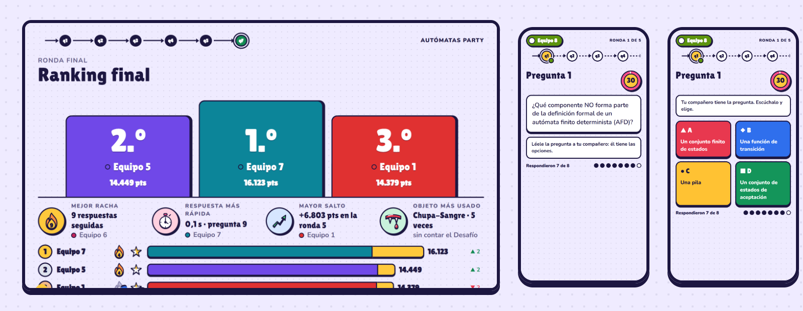

Lo hicimos para una exposición universitaria (la definición del autómata de pila y los lenguajes que
acepta). La sesión tiene tres partes y cada una es una página del mismo servidor:

| Parte | Qué es | Dónde |
| ----- | ------ | ----- |
| **Diapositivas** | La exposición, con diagramas que se ejecutan paso a paso sobre un simulador de autómatas de pila. Se avanza desde el celular. | `/slides/` (proyector) y `/remote/` (control) |
| **Taller** | Cada grupo registra su equipo y hace dos ejercicios a su ritmo, sin puntos ni cronómetro. | `/play/` |
| **Quiz** | 11 preguntas en 6 rondas, con objetos, cinco minijuegos, estrellas y duelos. | `/play/` (celulares), `/screen/` (proyector) y `/host/` (quien dirige) |

## Cómo se ve

**En el proyector** (`/screen/`): la sala con el QR, el resultado de cada pregunta, los minijuegos y
el ranking.

| | |
| :-: | :-: |
| 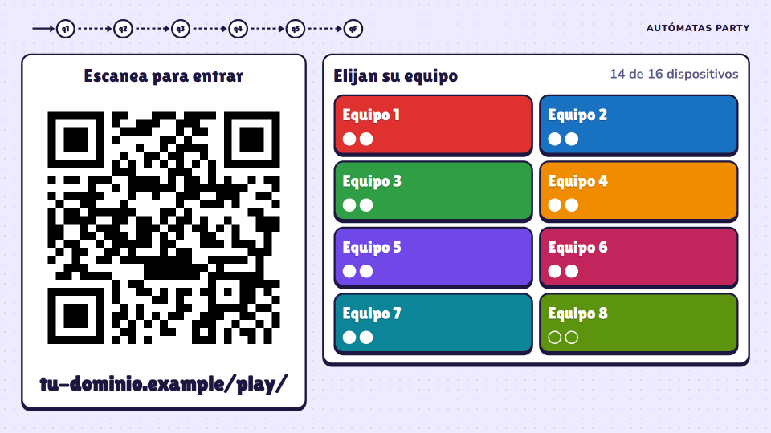 | 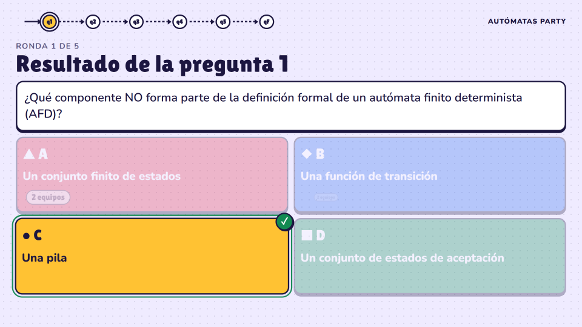 |
| La sala: el QR y los equipos | El resultado de una pregunta |
| 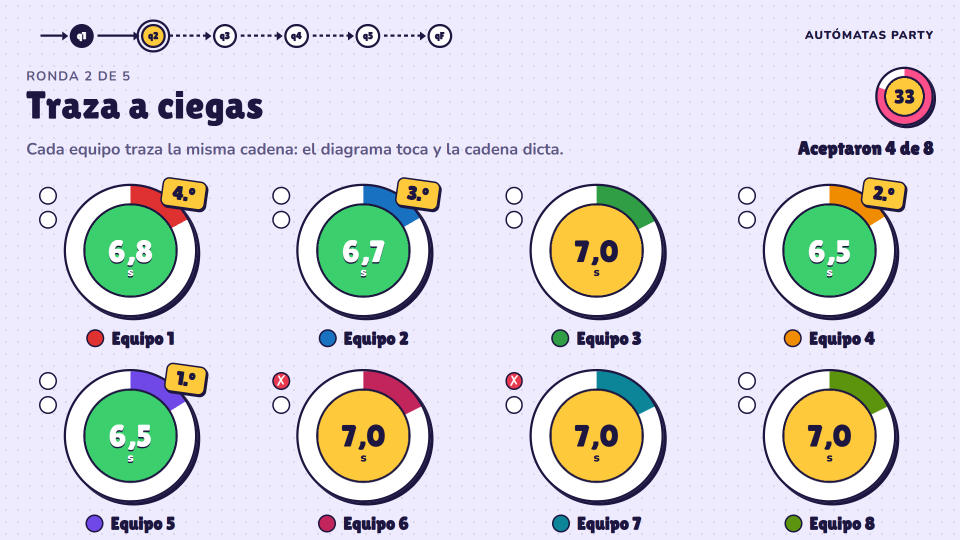 | 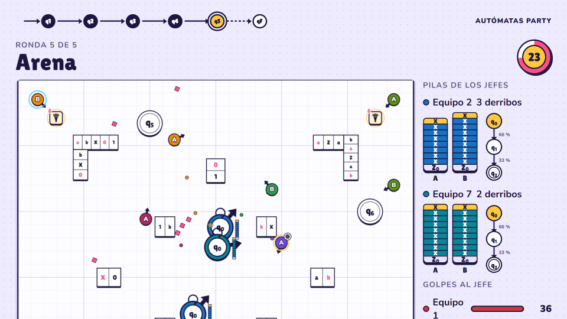 |
| Minijuego «Traza a ciegas» | Minijuego «Arena»: todos contra el jefe |

**En el celular** (`/play/`): cada equipo juega con dos celulares, y en las preguntas uno ve el
enunciado y el otro las opciones.

| | | | | |
| :-: | :-: | :-: | :-: | :-: |
| 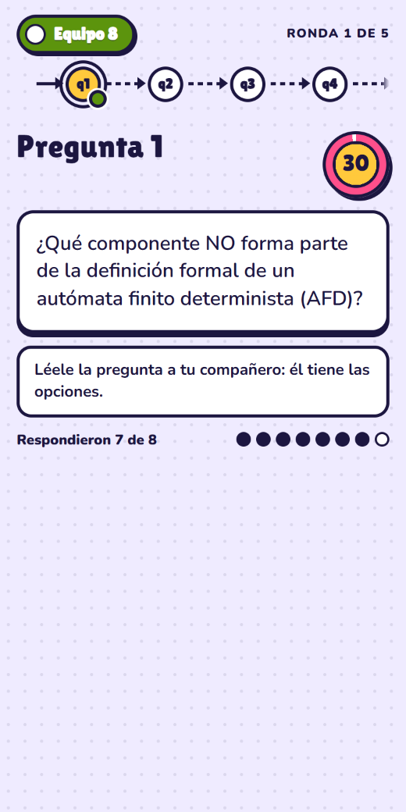 | 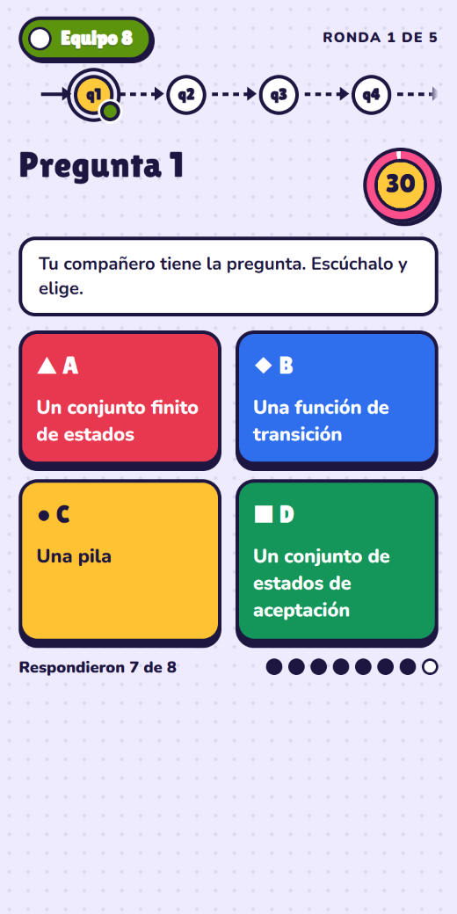 | 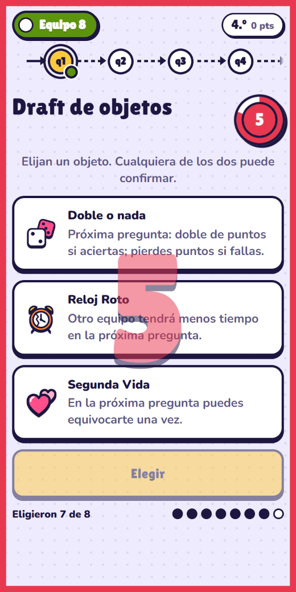 | 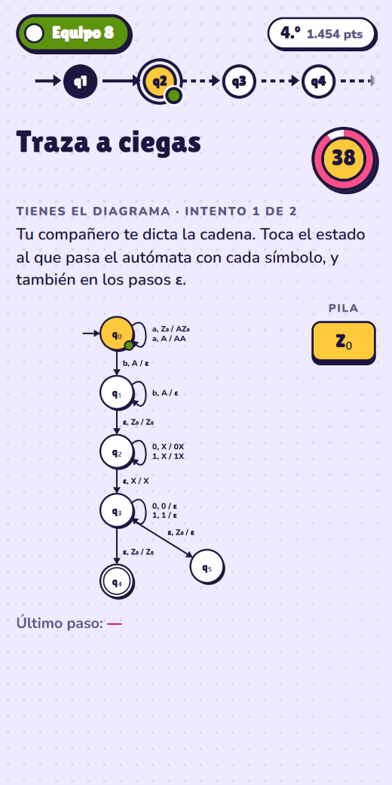 | 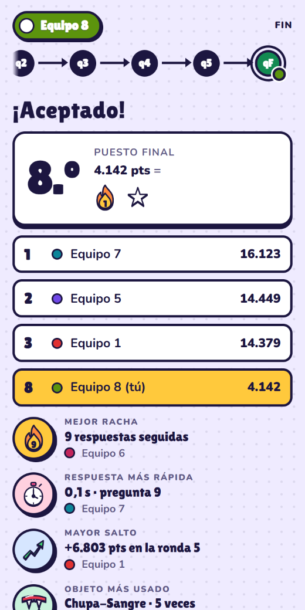 |
| Un celular tiene la pregunta… | …y el otro, las opciones | Elegir un objeto | «Traza a ciegas» | El final |

**Las diapositivas** (`/slides/`) y su control (`/remote/`): cada toque de «Siguiente» ejecuta un
paso del autómata; el celular muestra la nota de ese paso y el cronómetro.

| | | |
| :-: | :-: | :-: |
| 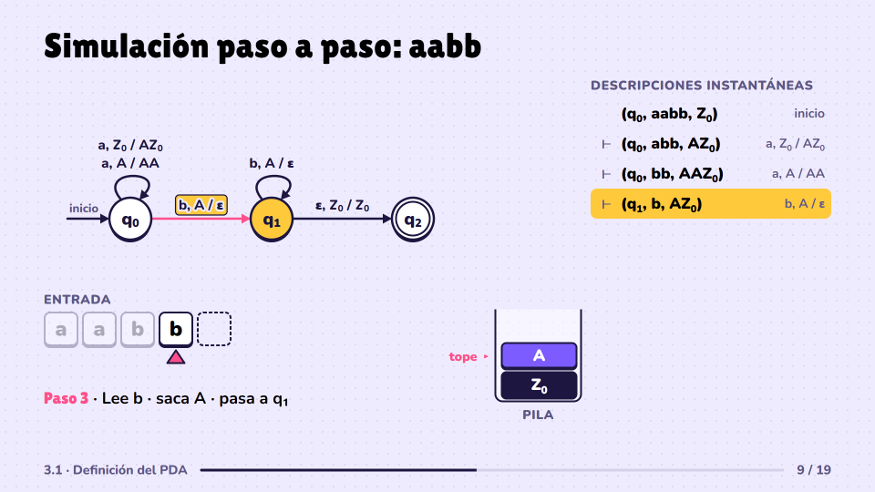 | 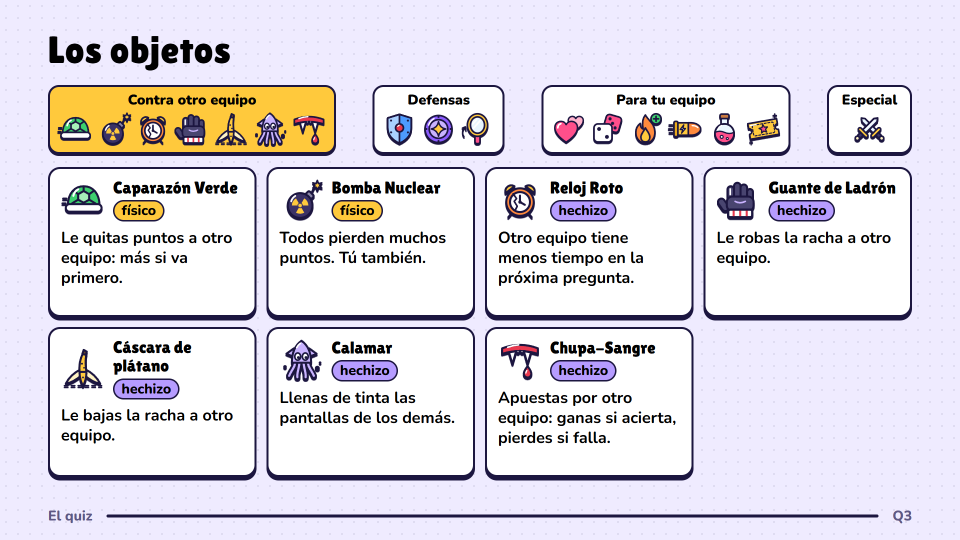 | 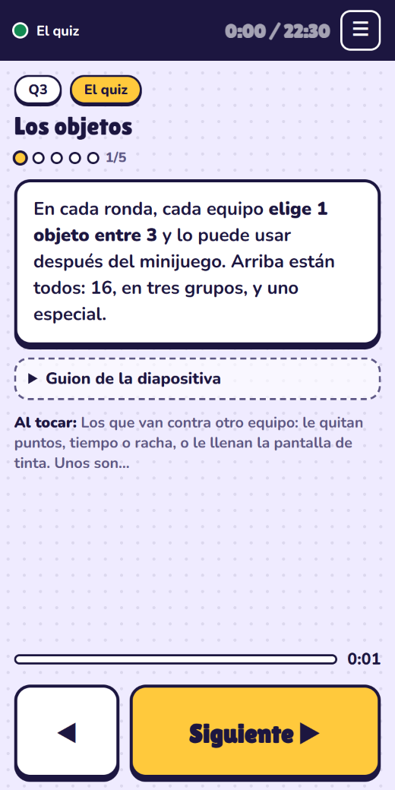 |
| Una ejecución paso a paso | Las reglas del quiz | El control |

**El panel del host** (`/host/`): crear la sala, avanzar, pausar, ajustar puntos y descargar las
estadísticas.

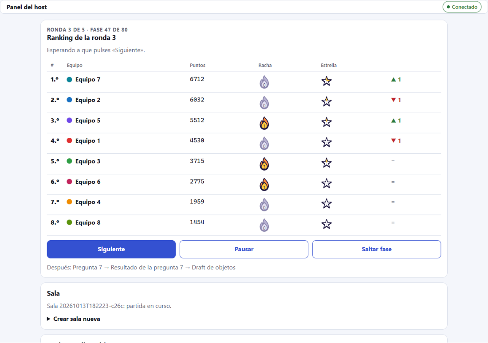

## Cómo funciona

### La sesión

1. **Exposición.** El proyector abre `/slides/` y los expositores la manejan desde `/remote/` en sus
   celulares (o con el teclado o un clicker). La posición la guarda el servidor: se puede recargar el
   proyector a mitad de una animación y vuelve al mismo punto.
2. **Taller.** El host crea una sala «con registro de equipos». Una persona de cada grupo entra con el
   QR, escribe el nombre del equipo y sus integrantes, y el grupo resuelve dos ejercicios: «Sé la
   pila» (qué le pasa a la pila en cada paso) y «Repara el autómata» (armar la transición que falta).
3. **Quiz.** Cuando cada equipo tiene sus dos celulares, el host inicia la partida.

### El quiz

- **6 rondas, 11 preguntas.** Las primeras cinco rondas son: pregunta, elegir un objeto, pregunta,
  minijuego y usar el objeto. La sexta es una sola pregunta. El avance se dibuja como un autómata
  (q₁ … q₅ y q_F).
- **Preguntas con dos celulares.** Uno muestra el enunciado y el otro las opciones, y se turnan: el
  equipo tiene que hablar. Hay una sola respuesta por equipo; responder rápido y acertar seguido
  (racha) da más puntos.
- **Objetos.** En cada ronda el equipo elige uno entre tres: ataques (quitar puntos, tiempo o racha,
  llenar de tinta las pantallas), defensas y mejoras propias. A quien va atrás le salen mejores.
- **Minijuegos.** Uno por ronda: Memoria de parejas y Alimenta el Autómata (en grupos de dos
  equipos), Traza a ciegas y Flappy (cada equipo por su cuenta) y la Arena (todos contra el equipo
  que va primero).
- **Estrellas y duelos.** Ganar un minijuego da un fragmento de estrella; cinco hacen una estrella,
  que vale mucho. El objeto «Desafío» reta a otro equipo a piedra, papel o tijera: quien reta y gana
  se lleva sus estrellas.
- **La nota** sale solo de las respuestas correctas (5 × aciertos ÷ preguntas). El puesto, los
  objetos y los minijuegos son el juego, no la calificación.

### Por dentro

- **Servidor autoritativo.** Node.js con Express y Socket.IO. Los clientes son páginas web sin
  compilar (módulos ES, sin framework): solo envían acciones y dibujan lo que el servidor les manda.
- **Una máquina de estados.** La partida es una lista fija de fases (`server/core/RoundPlan.js`); el
  motor (`GameEngine.js`) entra en cada una, recibe acciones, vence plazos y pasa a la siguiente.
- **Cada pantalla recibe solo lo suyo.** El servidor arma una vista distinta para cada celular, para
  el proyector y para el host: el celular del enunciado nunca recibe las opciones, y nadie recibe la
  respuesta correcta antes de tiempo.
- **Relojes sincronizados.** Cada cliente estima su desfase con el servidor y las fases empiezan a
  una hora acordada, así todas las pantallas cambian a la vez.
- **Nada se pierde.** El estado se guarda en `data/` (una foto y un registro de eventos). Un celular
  que se desconecta o se recarga vuelve a su equipo con sus puntos y objetos; si el servidor se
  reinicia, la partida se retoma.
- **Sin base de datos.** Preguntas, objetos, tiempos y premios son archivos JSON que el servidor
  valida al arrancar.

El contrato entre cliente y servidor está en [docs/PROTOCOL.md](docs/PROTOCOL.md).

## Probarlo en tu computador

Requiere [Node.js](https://nodejs.org) 22 o superior.

```bash
git clone https://github.com/starts-with-effort/automatas-party-publico.git
cd automatas-party-publico
npm install
npm run dev          # http://localhost:3000, se reinicia al guardar cambios
```

Para verlo funcionar sin reunir celulares:

```bash
npm run demo         # juega una partida completa con 14 bots y muestra el resultado (~1,5 min)
```

Para jugar de verdad en local:

1. Abre <http://localhost:3000/host/>. Pide un token: sin archivo `.env`, el servidor genera uno
   temporal y lo escribe en la consola al arrancar (mensaje `HOST_TOKEN no está definido…`).
2. Crea una sala y abre <http://localhost:3000/screen/> en otra pestaña (el proyector).
3. Abre <http://localhost:3000/play/> en una o varias pestañas y entra a un equipo. Para llenar los
   demás equipos con jugadores simulados: `npm run bots -- --bots 14`.
4. Pulsa «Iniciar partida» en el panel del host.

Con celulares en el mismo WiFi: copia `.env.example` como `.env`, pon `HOST=0.0.0.0` y abre el
proyector con la dirección de red local que muestra la consola (campo `lan`), para que el QR apunte
a ella. `npm run start:fast` acorta los tiempos para ensayar.

Las diapositivas están en <http://localhost:3000/slides/> y piden otro token (`SLIDES_TOKEN`, que
también se genera y se escribe en la consola si falta). Más en
[docs/PRESENTACION.md](docs/PRESENTACION.md).

## Cómo editarlo

Casi todo el contenido se cambia en archivos de configuración, sin tocar el código. El servidor los
valida al arrancar y avisa qué está mal.

| Quiero cambiar… | Dónde |
| --------------- | ----- |
| Las preguntas | [server/config/questions.json](server/config/questions.json) |
| Tiempos, puntajes, número de equipos, premios | [server/config/game.json](server/config/game.json) |
| Los objetos: textos, valores, activar o desactivar | [server/config/items.json](server/config/items.json) |
| Qué objetos le salen a cada puesto | [server/config/pools.json](server/config/pools.json) |
| El orden y las reglas de los minijuegos | `minigames` y `minigameRules` en `game.json` |
| Las diapositivas y sus notas | [presentacion/deck/deck.js](presentacion/deck/deck.js) y `presentacion/deck/slides/` |
| Los ejercicios del taller | `server/domain/workshop.js` |

**Preguntas.** Son 11 (dos por ronda y la final). Cada una tiene `id`, `difficulty` (`basica`,
`intermedia` o `dificil`), `statement`, `options` (cuatro), `correct` (índice de 0 a 3) e `image`
opcional (una ruta dentro de `client/assets/`, por ejemplo `questions/q3.png`). El tiempo para
responder sale de la dificultad (30, 45 y 60 s) y se puede fijar por pregunta con `timeLimitMs`.

**Objetos.** `items.json` tiene el nombre, el texto que ve el jugador, la ilustración y los valores
numéricos (`params`). Con `"enabled": false` un objeto deja de salir. Las reglas de cada uno están
en `server/domain/items/` (un archivo por objeto). Un objeto nuevo necesita su dibujo en
`client/assets/items/`: [docs/ICONOS.md](docs/ICONOS.md) explica cómo hacerlo.

**Minijuegos.** Cada uno es un módulo en `server/minigames/` con la misma interfaz (comentada en
`index.js`) y su pantalla en `client/shared/`. La lista `minigames` de `game.json` dice cuál va en
cada ronda; uno desactivado se reemplaza por «Alimenta el Autómata».

**Diapositivas.** `deck.js` es el manifiesto: orden, título, quién expone, tiempo asignado y una
nota por paso. Cada diapositiva es un archivo en `presentacion/deck/slides/` que arma sus pasos con
GSAP. Los autómatas de ejemplo están en `presentacion/deck/pda/examples.js` y sus ejecuciones salen
del simulador, así que ninguna traza proyectada puede estar mal.

**Aspecto.** Colores, fuentes y piezas del juego: `client/shared/party.css` y `base.css`. Los de la
presentación: `presentacion/deck/theme.css` y `deck.css`.

## Pruebas y herramientas

```bash
npm test                    # pruebas unitarias y de integración (partidas completas con bots)
npm run demo                # partida completa con 14 bots en un solo proceso
npm run demo -- --real      # la misma con los tiempos reales
npm run bots -- --bots 14   # jugadores simulados contra un servidor que ya está corriendo
npm run load                # prueba de carga: 30 clientes juegan una partida y se miden CPU, memoria y latencia
npm run duration            # cuánto dura la partida con la configuración actual
npm run slides:tiempos      # cuánto duró cada diapositiva en el último ensayo
```

- **Bots.** Con `--create-room --drive --host-token <token>` crean la sala y juegan la partida
  completa solos; `--url` apunta a otro servidor; `--practice <minijuego>` arma una sala para
  practicar un solo minijuego en bucle; `--taller` crea una sala con registro. Todas las opciones
  están al inicio de [scripts/bots.js](scripts/bots.js).
- **Carga.** `npm run load` levanta su propio servidor y termina con error si no se cumplen los
  límites: CPU por debajo del 50 %, memoria por debajo de 500 MB, 95 % de los mensajes entregados
  en menos de 250 ms y las pantallas sincronizadas con menos de 100 ms de diferencia. `--outages`
  agrega dos cortes de red de 10 s; `--real` usa los tiempos reales; `--url … --host-token … --confirm`
  la corre contra un servidor desplegado (crea una sala nueva); `--json <archivo>` guarda el informe.
- **Duración.** `npm run duration` muestra el tiempo fijo y el máximo de la partida; con
  `--log data/events-<sala>.jsonl`, lo que duró de verdad una partida ya jugada.
- **Estadísticas.** Desde `/host` se descarga un libro de Excel con todas las tablas (la primera hoja
  es la lista de estudiantes con su nota), los CSV sueltos y el registro completo en JSON.

## Despliegue

Es un solo proceso de Node sin base de datos: sirve en cualquier máquina con Node 22 (`npm ci` y
`npm start`). Para usarlo con celulares por internet hace falta HTTPS; nosotros lo corrimos en una
máquina virtual con Linux, con [Caddy](https://caddyserver.com) delante (pone el certificado y pasa
el tráfico, incluidos los WebSocket, al puerto de Node) y el servidor como servicio de systemd.
`GET /health` dice qué versión está corriendo. El repositorio incluye un flujo de GitHub Actions
que corre las pruebas en cada push (`.github/workflows/`).

Los secretos van en un archivo `.env` que no se sube al repositorio ([.env.example](.env.example)
dice cuáles son): `HOST_TOKEN` para el panel del host, `SLIDES_TOKEN` para las diapositivas y
`PUBLIC_URL`, la dirección que va en el código QR.

## Estructura del repositorio

```
server/
  index.js              arranque: .env, configuración, estado guardado, Express + Socket.IO
  app.js                rutas HTTP (/health, QR, exportación, métricas) y archivos estáticos
  config/               game.json, questions.json, items.json, pools.json y fast.json (ensayo)
  core/                 GameEngine (máquina de estados), RoundPlan, vistas por rol, persistencia
  phases/               un archivo por tipo de fase: pregunta, reparto, uso de objetos, minijuego, duelo
  minigames/            un módulo por minijuego: Memoria, Traza a ciegas, Clicker, Flappy, Arena
  domain/               reglas puras: puntaje, objetos (items/), suerte, estrellas, taller, estadísticas
  transport/            Socket.IO: esquemas de los mensajes, token del host, límite de frecuencia
  slides/               la presentación: sesión, rutas protegidas y posición actual
client/
  play/ screen/ host/   las tres páginas del juego: celular, proyector y panel
  shared/               conexión, reloj, piezas de la interfaz, estilos y el dibujo de cada minijuego
  assets/               fuentes e ilustraciones (un SVG por objeto)
presentacion/
  display/ remote/      el proyector y el control del celular
  deck/                 manifiesto, motor de pasos, simulador de autómatas de pila y una diapositiva por archivo
scripts/                bots, partida de demostración, prueba de carga, duración y tiempos del ensayo
tests/                  pruebas con node:test
docs/                   la documentación de abajo y las imágenes de este archivo
.github/workflows/      las pruebas en cada push (GitHub Actions)
```

## Documentación

| Documento | De qué trata |
| --------- | ------------ |
| [docs/PRESENTACION.md](docs/PRESENTACION.md) | Las diapositivas: cómo se usan, cómo funcionan y la estructura de la exposición |
| [docs/TALLER.md](docs/TALLER.md) | El taller y el registro de equipos |
| [docs/PROTOCOL.md](docs/PROTOCOL.md) | Mensajes entre cliente y servidor y formato de las vistas |
| [docs/ARENA.md](docs/ARENA.md) y [docs/TRAZA.md](docs/TRAZA.md) | Diseño de los minijuegos Arena y Traza a ciegas |
| [docs/ICONOS.md](docs/ICONOS.md) | Cómo dibujar la ilustración de un objeto |

Estos documentos se escribieron mientras se construía el proyecto: explican por qué algo es como
es, y partes de ellos cuentan etapas que ya pasaron.

## Tecnología

Node.js 22, [Express](https://expressjs.com) 5, [Socket.IO](https://socket.io) 4,
[Zod](https://zod.dev) para validar la configuración y los mensajes,
[GSAP](https://gsap.com) para las animaciones de las diapositivas y `qrcode` para el código de
entrada. El cliente es HTML, CSS y JavaScript sin paso de compilación.

## Licencia

[MIT](LICENSE): puedes usarlo, copiarlo, modificarlo y distribuirlo para lo que quieras, también con
fines comerciales; solo hay que conservar el aviso de la licencia. Se entrega tal cual, sin garantías.

Las fuentes incluidas (Lilita One y Nunito) son de sus autores y se distribuyen con la
[SIL Open Font License](https://openfontlicense.org).
